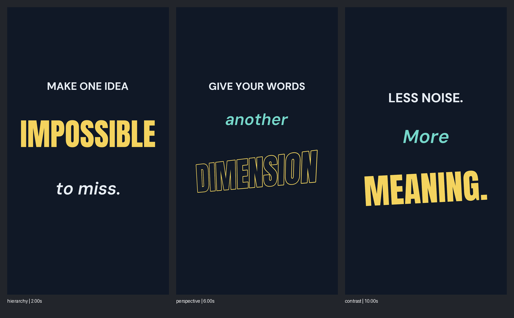

# Shortform Kinetic Typography

A reusable Codex skill for expressive video text: hierarchy, mixed scale, restrained accents, subject overlap and perspective. Includes detailed recipes, production/QA guidance, a portable plan, a linter and a Pillow still-preview helper.



## Install and use

From your Codex skills directory, normally `~/.codex/skills/`, clone the repository:

```bash
git clone https://github.com/collinsanfo/shortform-kinetic-typography.git
```

Alternatively, download and extract the source ZIP, then copy the folder into your skills directory as `shortform-kinetic-typography`. The resulting path should be `~/.codex/skills/shortform-kinetic-typography/SKILL.md`. Open a new session if the current session has cached its skill inventory.

> Use $shortform-kinetic-typography to restyle this video's text using my references. Preserve the narration, wording and product artwork.

Supports review-only requests and calm graphic sequences as well. A paid video service is not required.

## Helpers

Python 3.10+ is the target runtime. Run these commands from this folder. The linter uses the standard library; previews need Pillow:

```bash
python -m pip install -r requirements.txt
python scripts/lint_plan.py assets/example-plan.json
python scripts/render_preview.py assets/example-plan.json --output preview.png
python scripts/test_helpers.py -v
```

See [the plan contract](references/plan-format.md). The helper renders still compositions, not a finished animated film or synthesized audio.

## Reuse and contributions

Code and instructions: MIT. Bundled fonts: separate OFL licences with hashes/sources. No personal recordings, product assets, API keys or reference-creator screenshots are included.

For a new recipe, document appropriate use, failure cases and an observable example. Exercise a valid and a meaningful invalid plan when changing scripts. Keep brand preferences configurable and avoid unverified performance claims.

Version 0.1.0. [Source repository](https://github.com/collinsanfo/shortform-kinetic-typography) · [MIT licence](LICENSE).
